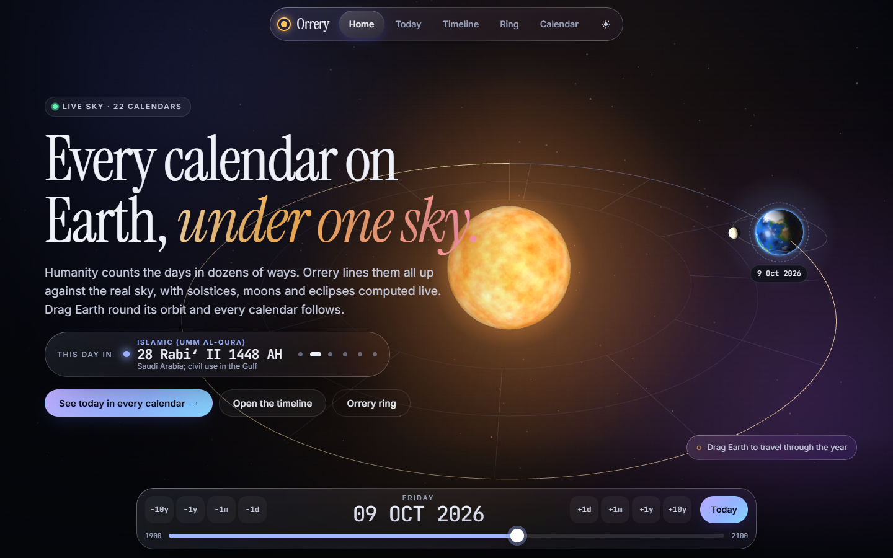

# Orrery



Earth's calendars, side by side. Orrery shows today's date in 22 calendar systems at once, draws
them as swimlanes against the sky's solstices, equinoxes, moons and eclipses, wraps them around the
Sun as concentric rings, and presents one new invented calendar anchored to the real December
solstice.

Everything is mouse-driven: no typing is ever needed. Date steppers hold-to-repeat, a slider scrubs
1900 to 2100, and the charts pan, zoom and select by dragging, scrolling and clicking. It is also
keyboard accessible and responsive. It is dark-first (a deep-space observatory look with glass panels, film grain and motion that respects `prefers-reduced-motion`), with a full light theme.

## The views

- **Home**: a live WebGL scene (three.js, lazy-loaded) with the Sun, Earth at its real position for the
  selected date, and the Moon at its real phase. Drag Earth around its orbit to change the date.
  A strip cycles the date through several calendars. Falls back to a static scene without WebGL.
- **Today**: the chosen date in every calendar as cards grouped by family (solar, lunar, lunisolar,
  day counts, invented), plus the moon phase and the nearest solstice, equinox, new and full moon,
  eclipses and apsis.
- **Timeline**: one lane per calendar with month bands across a window (a Gregorian year by
  default). Drag to pan, scroll to zoom, hover for the date in that lane's calendar, click to pick
  a day. Heavy lines mark where each calendar starts a year. Toggle sky events and lanes.
- **Orrery ring**: one solstice-to-solstice orbit around the Sun with Earth at its true position and
  the months of the calendars you choose as concentric rings.
- **Orrery calendar**: the invented calendar's year as 13 month cards, softly lit workdays, calm days off, a
  gold festival month, with hover showing the Gregorian date, a year stepper, and the 365/366 year lengths
  around the current year.

## Calendars

Gregorian, Julian, ISO week date, Holocene, Persian (Solar Hijri), Indian national (Saka), Ethiopian,
Coptic, Egyptian civil, French Republican (Romme rule), Thai Buddhist, Japanese era, ROC (Minguo),
Islamic (Umm al-Qura and tabular civil), Hebrew, Chinese, Korean (Dangi), Maya (Long Count, Tzolk'in,
Haab'), Julian Day Number, Unix time, and the Orrery calendar. Algorithms, epochs and known limits
are in [docs/CALENDARS.md](docs/CALENDARS.md).

## The Orrery calendar

Twelve 30-day months in locked 10-day weeks (6 workdays, 4 days off), then a year-end festival of 5
days (6 in leap years). The year starts on the UTC day of the real December solstice, so leap years
come from the sky rather than a rule. The full specification, with a comparison to the French
Republican and Egyptian calendars and workday statistics, is in
[docs/ORRERY_CALENDAR.md](docs/ORRERY_CALENDAR.md). Month and weekday names are placeholders in
`src/calendars/orrery-config.ts`.

## Run it

You need Node 20 or newer.

```bash
npm install
python run.py            # dev server and browser
npm run verify           # types, lint, tests
npm run build            # static site into dist/
```

`python run.py doctor` checks prerequisites. The site builds for GitHub Pages at `/orrery/`.

## Built with

[astronomy-engine](https://github.com/cosinekitty/astronomy) for solstices, equinoxes, moon phases,
eclipses and apsides; the platform's `Intl.DateTimeFormat` calendars for the non-Gregorian systems
that ICU implements; Vite and TypeScript; [three.js](https://threejs.org) for the home scene (loaded only on the Home view); self-hosted
Instrument Serif, Inter and JetBrains Mono via Fontsource; nothing else at runtime.

## Contributing

Read [AGENTS.md](AGENTS.md) for the layout and the rules (notably: no em dashes, mouse-first UI,
tests for every calendar). Licensed MIT.
